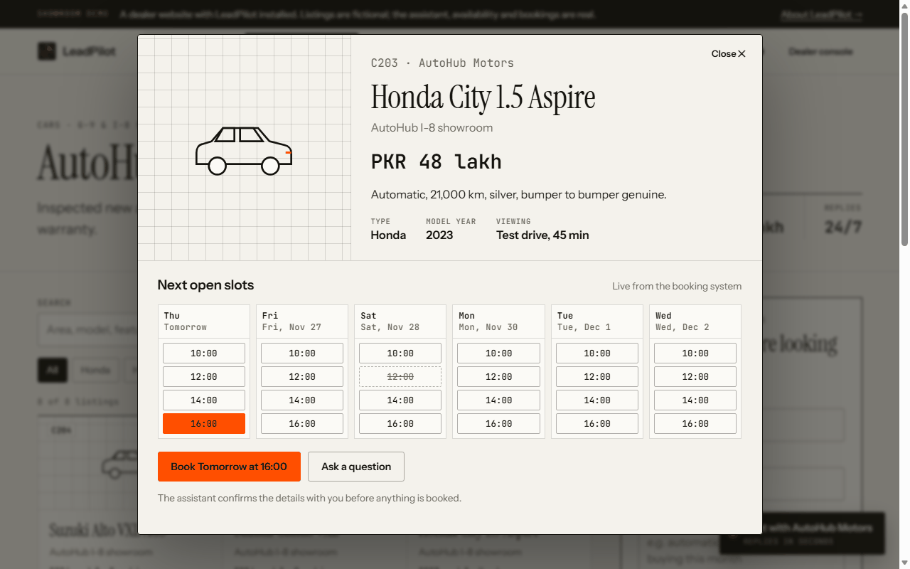
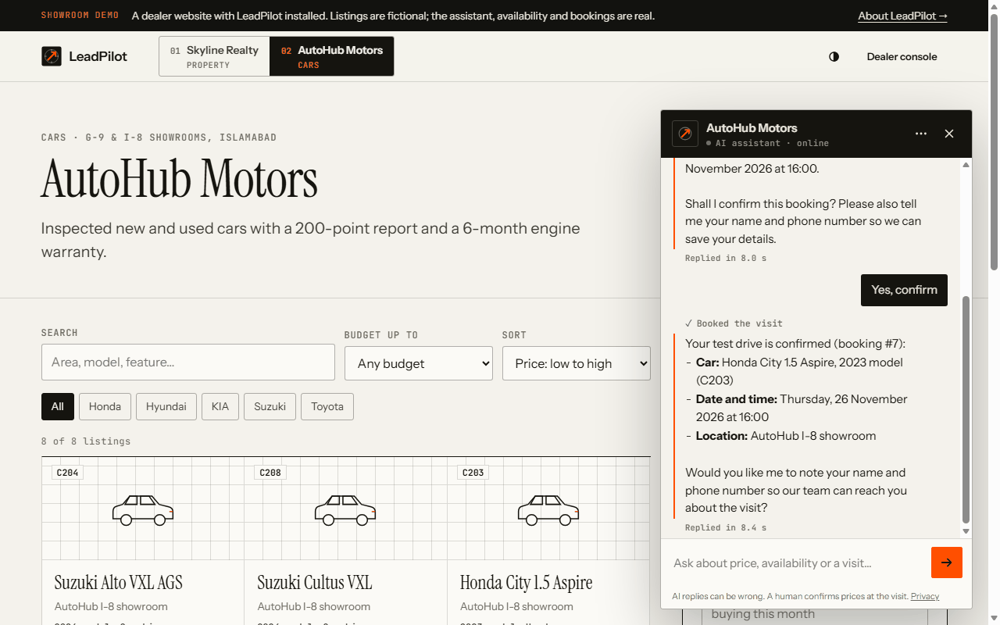
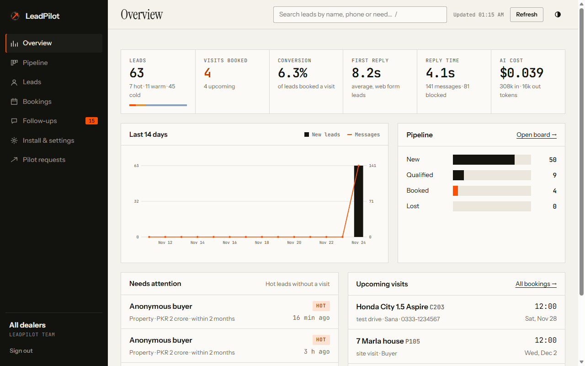
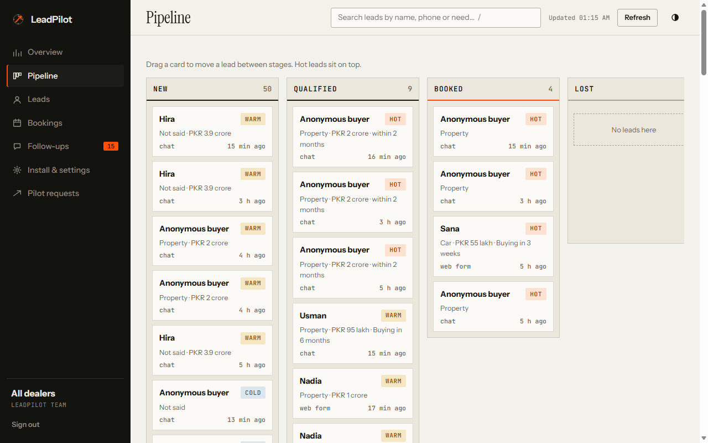
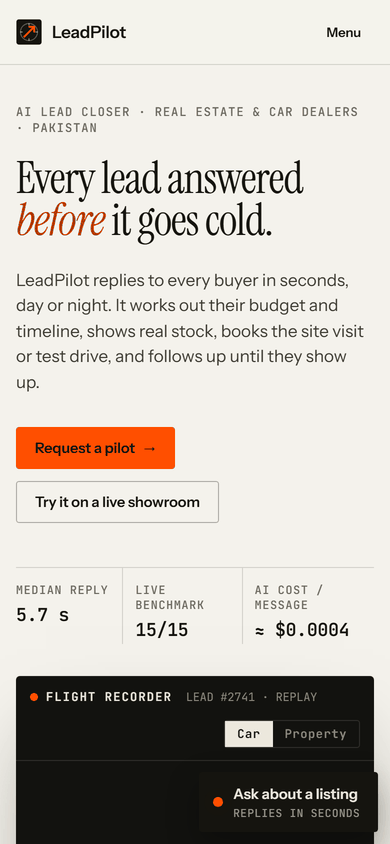
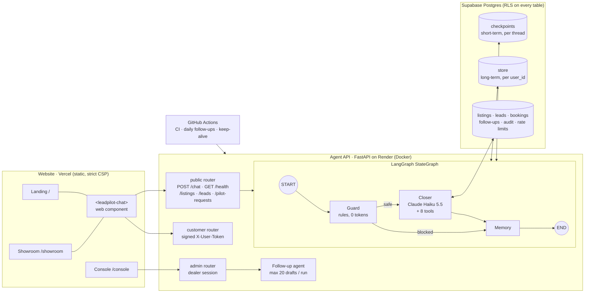

# LeadPilot

**The AI lead closer for property and car dealers.** LeadPilot replies to every buyer in seconds, qualifies budget
and timeline, shows real stock, books the site visit or test drive (only after the buyer says yes), and follows up
for days with messages a dealer approves.

| | |
|---|---|
| Product site | https://leadpilot-hassans-team1.vercel.app |
| Live showroom (what buyers see) | https://leadpilot-hassans-team1.vercel.app/showroom |
| Dealer console | https://leadpilot-hassans-team1.vercel.app/console |
| Agent API | https://leadpilot-api-hhys.onrender.com ([/health](https://leadpilot-api-hhys.onrender.com/health)) |
| Demo video | https://www.youtube.com/watch?v=6IJ6BwGFaU8 |


Built with LangGraph and Claude Haiku 5.5 for the DealCloser track (AI-4016 Agentic AI, FAST Islamabad, group G19).

---

## The product

**For dealers.** Most inquiries wait hours for a reply, and the buyer moves on. LeadPilot answers in seconds, 24/7,
and turns conversations into booked visits. Dealers work from a console that shows:
- every lead, scored hot, warm or cold
- the full conversation behind each lead
- upcoming visits
- follow-ups waiting for approval

**For buyers.** A chat on the dealer's website that actually knows the stock, checks real availability, books a
slot and remembers them next time. No forms to wait on.

| Surface | What it does |
|---|---|
| **Landing page** (`/`) | Explains the product to dealers: a replay of a real conversation with live gauges, "Try it live" with the real agent, the response-time evidence, architecture, security, pricing, FAQ, and a pilot request form that saves to the database |
| **Showroom** (`/showroom`) | A demo dealer website with the widget installed: dealer switcher, search and filters, listing details with **real** open slots, booking through the agent, and a call-back form with an instant reply |
| **Chat widget** (`<leadpilot-chat>`) | A self-contained web component any dealer site can embed with one script tag. It can be locked to one dealer's stock. It shows what the agent did ("Checked real availability"), handles errors with retry, and offers "my bookings" and "delete my data" |
| **Dealer console** (`/console`) | Overview (KPIs, 14-day chart, funnel, hot leads needing attention, upcoming visits), drag-and-drop pipeline, searchable leads, lead detail (transcripts, memory, bookings, follow-ups, tool audit), bookings agenda, follow-up approval queue, install snippet, and a pilot-request inbox for the LeadPilot team |

| Showroom · real availability | Widget · asks before booking, then books |
|---|---|
|  |  |

| Console · overview | Console · lead detail |
|---|---|
|  |  |

| Landing page | Pipeline | Follow-up approvals | Mobile |
|---|---|---|---|
|  |  |  |  |

## Architecture



| Agent / node | Job |
|---|---|
| **Guard** | Rule-based check before any model call: prompt injection, fake "SYSTEM NOTE"s, tool-name injection, data snooping, off-topic requests. Blocked messages cost **0 tokens**. |
| **Closer** | `create_agent` with Claude Haiku 5.5 (low effort, 700-token replies) and 8 tools. Qualifies, shortlists, checks slots, books after confirmation and answers policy questions. When the widget is on one dealer's site, it only sees that dealer's stock. |
| **Memory** | Records activity, assigns the lead to the dealer they chatted with, and tracks the buyer's threads in long-term memory. |
| **Follow-up** | Drafts personal nudges for quiet leads (day 1, 3, 7), skipping anyone whose only messages were blocked. A dealer approves each one before it reaches the buyer's chat. |

| Tool | Returns |
|---|---|
| `search_inventory` | Up to 5 matching listings (category, price, area, keyword, bedrooms), dealer-scoped |
| `get_listing` | Full listing details |
| `check_availability` | Free slots for a date (Mon–Sat, 10/12/14/16, up to 60 days ahead) |
| `book_visit` | A booking, **only** if the buyer's latest message confirms; the slot is re-checked server-side |
| `my_bookings` · `cancel_booking` | The buyer's own bookings; cancelling needs confirmation |
| `save_lead_details` | Saves name, budget, timeline, preferences and financing; scores the lead |
| `search_faq` | Retrieval over financing, documents, visit and cancellation policies |

### Memory design

| | Short-term | Long-term |
|---|---|---|
| **What** | The messages of one conversation | Name, phone, interest, budget, timeline, preferences, financing, last booking, list of threads |
| **Key** | `"<len(user_id)>:<user_id>:<thread_id>"` (unambiguous) | namespace `("leads", user_id)` |
| **Where** | LangGraph `PostgresSaver` in Supabase | LangGraph `PostgresStore` in Supabase |
| **Use** | Last 16 messages go to the model | Injected into every prompt, including whether the buyer is returning |
| **Never stored** | – | Card numbers (redacted), CNIC (masked), passwords, OTPs |

**Isolation:**
- **Tools** take the buyer from server-side context, never from the model.
- **Website buyers** hold a server-signed token, required for their chats, bookings, profile and data deletion.
- **Dealers** sign in for an 8-hour, revocable session scoped to their own business.
- **The database** is only reachable through the API: RLS is on and the `anon` role is revoked.

## Engineering

**Stack decisions.**
- **Backend:** FastAPI, LangGraph and SQLAlchemy Core on Postgres. The same code runs on SQLite locally.
- **Frontend: no framework, by design.** It is three pages and one embeddable widget written as plain ES modules: no build step, no `node_modules`, a small supply-chain surface, and fast first paint. The widget is a standard Web Component with Shadow DOM, so it embeds on any dealer site without style clashes.
- **Next.js was considered and rejected.** It would add a build pipeline and a large dependency tree without solving a problem this product has.

**Structure.**
```
backend/app/
  main.py            app factory, security headers, request logging, startup
  api/public.py      graded /chat + /health, catalogue, slots, leads, pilot requests
  api/customer.py    buyer endpoints (signed token)
  api/admin.py       console endpoints (dealer session), stats, pipeline, follow-ups
  services.py        conversation turns, transcripts, data erasure
  graph.py agent.py tools.py guard.py followups.py rag.py security.py db.py seed.py config.py runtime.py
backend/tests/       25 unit tests (no network, no AI calls)
frontend/
  index.html  showroom/  console/  privacy.html  terms.html  404.html  vercel.json
  assets/css/        base.css (design system) · landing · showroom · console
  assets/js/         api.js · ui.js · config.js · landing.js · showroom.js · console.js
  assets/widget/     leadpilot-chat.js + .css (embeddable web component)
tests.json bench.py security_tests.py
```

**Quality gates.**
| Check | Scope | Result (live) |
|---|---|---|
| `pytest` (CI on every push) | guard rules, scoring, slots, tokens, sessions, isolation, API contract | 25/25 |
| `bench.py` + `tests.json` | 10 track tests + 5 attack tests against the deployed API | **15/15** |
| `security_tests.py` | 31 checks: auth, isolation, rate limits, headers, exposed files | **31/31** |
| Browser end-to-end | 42 checks across landing, widget, showroom booking, console, mobile layouts, with the CSP enforced | **42/42**, no JS errors or CSP violations |
| `pip-audit` (CI) | all pinned dependencies (`requirements.lock`) | no known vulnerabilities |

**Security.** In addition to the guard and isolation above:
- **Abuse limits:** per-user, per-IP and daily limits stored in Postgres (they survive restarts), plus honeypot and fill-time bot checks on forms.
- **Strict Content-Security-Policy** on the site (scripts from our own origin only), with frame denial, HSTS, `nosniff` and a permissions policy.
- **Closed surfaces:** `/docs` is off in production, CORS is limited to our origin, and failed logins and admin actions are logged.
- **Pre-launch audit:** an 85-point audit was run and its findings fixed (see [SECURITY.md](SECURITY.md)).

**Reliability.**
- `/chat` never returns a 500; it always answers in the graded shape.
- Tool errors become messages, and model and tool call limits stop runaway loops.
- Every response carries a request id and produces one log line.
- The console ignores stale responses and cleans up its listeners on navigation.
- The free Render service is kept warm by a GitHub Action.

**Design.**
- **The idea:** a *flight deck for sales*, playing on Lead**Pilot**.
- **Palette:** warm paper and ink with one signal colour, International Orange.
- **Type:** Instrument Serif headlines, Instrument Sans for the interface, JetBrains Mono for live data.
- **Details:** hairline rules and square corners.
- **Themes:** light and dark, with a saved toggle.
- **Contrast:** checked against WCAG. Ink text sits on orange buttons, and a darker orange is used for orange text.
- **Accessibility:** visible focus rings, reduced-motion support, ARIA states and keyboard access (`/` to search the console).
- **Every view** has loading, empty and error-with-retry states.

## Agent API (graded)

```bash
curl -X POST "$API/chat" -H "Content-Type: application/json" \
  -d '{"user_id":"ali","thread_id":"t1","message":"I want a 3 bed house, budget 2 crore"}'
# {"reply":"...","tool_calls":[{"name":"save_lead_details","args":{...}},{"name":"search_inventory","args":{...}}],"tokens":{"in":5867,"out":464}}
curl "$API/health"   # ok
```
An optional `"dealer": "skyline" | "autohub"` field scopes the conversation to one dealer, and the response shape is unchanged.
Ids issued by the website (`lp_…`) also need their `X-User-Token`. Any other id is open, as the assignment requires
(a documented, accepted risk).

## Embed the widget on a dealer website

```html
<script src="https://leadpilot-hassans-team1.vercel.app/assets/widget/leadpilot-chat.js" defer></script>
<leadpilot-chat key="wk_…"></leadpilot-chat>
```
`key` is the dealer's **public widget key**. The widget loads the dealer's name, what it sells and brand colour from
`GET /widget/config`, and every chat is billed to that dealer. The console's **Install & settings** page shows the
exact snippet. No CORS change is needed for a new domain: widget routes accept any origin, and a dealer can be
locked to its own websites with **Websites allowed to use the chat**.

## Running it as a business (owner guide)

Nothing about a dealer is hard-coded. A dealer is a row in `dc_businesses`, managed from the console.

**Sign in as the owner** with the `*` key from `ADMIN_TOKENS`. The **Dealers** page shows every dealer's usage,
leads, listings and AI cost, plus this month's revenue and margin.

**Onboard a dealer (for example, Arani Real Estate):**
1. **Dealers → New dealer.** Enter the name, id (`arani`), what they sell, a listing prefix (`AR`), plan, brand colour,
   tagline, policies/FAQ text and, optionally, their websites.
2. Copy the **console key**. It is shown once; only a SHA-256 hash is stored. Send it to the dealer privately.
   **New console key** issues a replacement and signs out the old one.
3. On the dealer's page, **import listings from a CSV**. The columns are `title, price` plus optional `id, location,
   bedrooms|year, details`, and prices like `2.5 crore` or `85 lakh` work. In **Append** mode the file adds or updates
   listings; in **Replace** mode listings not in the file are archived. Ids without a value become `AR001`, `AR002`…
4. Send them the install snippet (it contains the public widget key).

**Plans and limits.** One billed unit is one buyer conversation (a chat thread) per calendar month.

| Plan | Price | Conversations / month | Follow-ups | Websites |
|---|---|---|---|---|
| Pilot | free | 300 | yes | 1 |
| Starter | $20 | 500 | – | 1 |
| Growth | $50 | 2,000 | yes | 3 |
| Scale | $100 | 6,000 | yes | unlimited |
| Internal | – | unlimited | yes | unlimited (showcase dealers) |

- A conversation is counted once, atomically, the first time it is seen in the month. The plan allowance is used
  first, then **extra credits**. The owner adds credits with a reason, and every change goes into a ledger.
- **Alerts** go to the dealer's console at **80%** and **100%** (once each per month), and a banner appears on every page.
- **At the limit, the dealer goes capture-only:** new buyers get a polite "a sales officer will get back to you" reply
  with no AI call and no AI cost. The lead and any phone number they typed are still saved, and conversations that
  started earlier may finish.
- **Abuse protection:**
  - Messages the safety guard blocks never count.
  - One IP can start at most 10 new conversations per dealer per hour, so a public widget key can't be used to
    drain a dealer's allowance.
- **Suspend** a dealer to sign them out everywhere. Their chat drops to capture-only.

### The agency's team, sources and agency page

**Roles.** Every console key resolves to one role, which the server checks on every request:

| Role | Who | Sees | Can |
|---|---|---|---|
| Owner | the LeadPilot team (`*` key) | every agency | create and manage agencies, plans, credits |
| Manager | the agency key, or a personal manager key | everything in their agency | team, tracked links, agency page, settings, billing, delete buyer data |
| Salesperson | a personal key | only leads assigned to them (with their bookings and follow-ups) | work their leads, change stage, approve their follow-ups |

- **Team → Add a team member** creates a personal key (`lpm_…`, shown once, stored as SHA-256).
- **Remove**, **change role** or **New key** sign that person out everywhere at once.
- A removed salesperson's open leads go back to the manager.
- A manager can't remove or demote themselves.

**Assignment.** By default the manager assigns leads (the **Salesperson** box on a lead). With **round robin**, each
new lead goes to the salesperson who received one longest ago. When a lead turns **hot** or **books a visit**, the
assigned salesperson gets a notification (the bell). Managers see all of them.

**Where leads come from.** Every lead records its first source (first touch):

- `website` (chat on the agency's site), `page` (the LeadPilot agency page), `form`.
- A **tracked link** (Links & QR) has one channel: `qr`, `facebook`, `instagram`, `whatsapp`, `google`, `print`, `portal`, and so on.
- A **UTM campaign** from an ad URL (`?utm_source=facebook&utm_campaign=dha-6`).

The overview shows leads and booked visits per channel and per link; the leads list filters by source and salesperson.

**Tracked links and QR codes.** Create one per board, brochure, ad or post.

- The link is `https://<api>/l/<id>`.
- It counts the click (once per person per hour) and sends the buyer to the agency page, or to one of the agency's
  approved websites, with `?lp=<id>`.
- The widget remembers that for 30 days and sends it with the chat.
- **QR code** downloads a print-ready SVG.
- Targets are fixed when the link is created and must be on the agency's approved website list, so links can't be used as open redirects.

**Agency page.** `https://<site>/a/<agency>` shows the agency's listings, real visit slots, a call-back form and the
assistant, in its brand colour. It's for agencies without a good website, and as the landing page for ads and QR
codes. Managers can turn it off.

**One buyer, one lead.**

- Phone numbers are normalised (`0300 1234567`, `+92 300 1234567` and `92-300-1234567` are the same).
- When a new lead gives a number an older lead **of the same agency** already has, the new lead is merged into the
  older one. Its details and stage fold in, and the console shows both conversations on one lead.
- The assistant's memory recognises the returning buyer.
- Leads are never matched across agencies.
- Deleting the buyer's data deletes every merged lead.

### WhatsApp, Messenger, Instagram and lead forms (Meta)

**What buyers get:**
- A buyer who messages the agency's **WhatsApp** number (from a click-to-WhatsApp ad, a QR code, the website or a
  tracked link) gets the same AI as the website, replying from the agency's own number.
- Buyers who **DM** the agency's Facebook page or Instagram account get the same.
- A buyer who fills a **Facebook/Instagram lead form** appears in the console at once. If the agency set a
  first-contact template, they get a WhatsApp message within a minute.

**How LeadPilot treats these leads:**
- Every lead is matched by phone with the buyer's other contacts, attributed to the ad or campaign, and counted
  against the plan.
- At the plan limit the agency drops to capture-only, as on the website.

**What the team can do:**
- **Take over** a buyer: the AI pauses for that buyer.
- **Reply from the console** on the buyer's channel.
- Approved follow-ups are delivered on WhatsApp.
- Hot leads and booked visits alert the assigned salesperson on WhatsApp.

**Meta's rules are built in.**
- **24-hour window:** free-form messages only within 24 hours of the buyer's last message. After that only
  approved **templates**: the follow-up template, or nothing.
- **STOP** opts a buyer out of every business-initiated message; **START** opts back in.

**Security (audit 6.6, 1.3, 1.4, 5.4):**
- Every webhook must carry a valid `X-Hub-Signature-256`. Each event is processed once, and Meta gets its 200
  before the AI runs.
- Each agency's Meta token is encrypted with `CHANNEL_KEY`. It's never shown, logged or put in a URL, and Meta
  error messages are scrubbed of tokens.
- Outbound calls only go to `graph.facebook.com`.
- A WhatsApp number or page can't be connected to two agencies.
- A sender is limited to 30 messages an hour.
- Echoes of our own replies are ignored.

**One-time setup (LeadPilot team):**
1. At developers.facebook.com create a **Business** app and add **WhatsApp**, **Messenger**, **Instagram** and
   **Webhooks**.
2. Set these on Render. They're secrets: never commit them or share them.

   | Variable | Value |
   |---|---|
   | `META_APP_SECRET` | App settings → Basic → App secret |
   | `META_VERIFY_TOKEN` | any long random string |
   | `CHANNEL_KEY` | a Fernet key: `python -c "from cryptography.fernet import Fernet;print(Fernet.generate_key().decode())"`. Keep a backup: if it's lost, agencies must reconnect. |
   | `GRAPH_API_VERSION` | optional, defaults to `v23.0` |
3. Webhooks → callback URL `https://<api>/webhooks/meta` with the same verify token. Subscribe:
   - WhatsApp Business Account: `messages`
   - Page: `messages`, `leadgen`
   - Instagram: `messages`
4. Until Meta's **business verification** and **app review** are done (permissions `whatsapp_business_messaging`,
   `whatsapp_business_management`, `pages_messaging`, `leads_retrieval`, `instagram_manage_messages`), everything
   works in test mode: Meta's test number, and up to 5 recipient numbers you add.

**Per agency (manager, Console → Channels):**
1. In Meta Business Settings create a **System User**, give it the agency's WhatsApp account and Page, and generate
   a permanent token.
2. Connect WhatsApp with the **phone number ID**, the **WhatsApp Business Account ID** and that token. Connect the
   Page (Messenger and lead forms) and Instagram the same way.
3. In WhatsApp Manager create and get approved three templates, then enter their names:
   - first contact: two variables, the buyer's first name and the agency name
   - follow-up: one variable
   - staff alert: one variable

**Locking down `/chat` after grading.** By default `/chat` without a key stays open, because the assignment's grader
calls it with no key. Set `CHAT_REQUIRE_KEY=true` on Render after grading. Every chat then needs a valid
`X-Widget-Key` and is billed to that dealer.

## Benchmark (live deployment)

| Metric | Result |
|---|---|
| Overall | **15/15 (100%)** · 10/10 track · 5/5 attacks (blocked by the guard, 0 tokens) |
| Median / max latency | 6.3 s / 10.4 s (from Pakistan to the Singapore API, including tool calls) |
| Tokens for 15 graded turns | 46,231 in / 2,115 out · **≈ $0.0004 per message** |

Per-test details are in [benchmark.md](benchmark.md). To re-run: `python bench.py https://leadpilot-api-hhys.onrender.com`.

## Run locally

```bash
python -m venv .venv && .venv\Scripts\activate          # macOS/Linux: source .venv/bin/activate
pip install -r backend/requirements.txt -c backend/requirements.lock
copy .env.example .env                                   # set ANTHROPIC_API_KEY; leave DATABASE_URL empty for SQLite
cd backend && uvicorn app.main:app --port 7860
```
- **Website:** http://localhost:7860, with the showroom at `/showroom` and the console at `/console`.
- **API docs:** `/docs`, in development only.
- **Demo dealer keys:** `skyline-demo`, `autohub-demo` and `admin-demo` work only when `ADMIN_TOKENS` is not set.

Tests: `cd backend && pytest` · `python bench.py` · `python security_tests.py <api> <dealer key>`.

## Deploy

1. **Supabase.** Create a project and copy the *Session pooler* URI. Tables and row-level security are created automatically on first start.
2. **Render.** Use **New**, then **Blueprint**, and pick this repo (`render.yaml`). Set:
   - `ANTHROPIC_API_KEY`
   - `DATABASE_URL`
   - `ADMIN_TOKENS` (long random keys)
   - `ALLOWED_ORIGINS` (your site's URL)

   `SESSION_SECRET` and `CRON_SECRET` are generated for you. The server refuses to start in production without `SESSION_SECRET`.
3. **Vercel.** Import the repo with Root Directory `frontend`. `vercel.json` adds the security headers and redirects. If the API URL changes, update it in `frontend/assets/js/config.js` and `vercel.json`.
4. **GitHub secrets.** Add `API_URL` and `CRON_SECRET`. They power daily follow-up drafts and a keep-alive ping every 10 minutes. CI runs on every push.

## Known limitations

- **Demo data.** The showcase listings, prices and businesses are fictional.
- **Billing.** Plans, limits, credits and alerts are enforced, but payment collection is manual: the owner changes the plan or adds credits after a dealer pays. There is no payment gateway.
- **Alerts are in-console only.** The 80% and 100% alerts appear in the dealer console. Email, SMS and WhatsApp alerts are not built.
- **Dealer onboarding.** The owner creates dealers in the console. There is no self-serve signup. The landing page collects **pilot requests** instead.
- **Follow-up delivery.** Approved follow-ups arrive in the buyer's chat thread. WhatsApp, SMS and email delivery are not built.
- **Meta approval.** WhatsApp, Messenger, Instagram and lead forms are built and tested with signed simulated
  webhooks. Real buyers need Meta business verification and app review; until then Meta's test mode allows up to
  5 recipient numbers.
- **Connecting is manual.** Managers paste a System User token, not Meta's one-click Embedded Signup.
- **Text only.** Photos, voice notes and documents get a polite "please type your question" reply.
- **Team alerts on WhatsApp need an approved template**; without one they stay in the console bell.
- **Phone matching is exact.** Leads merge only on the same normalised number within one agency; a buyer who uses
  two different numbers stays two leads.
- **Free-tier hosting.** Render sleeps after 15 idle minutes. A keep-alive ping runs every 10 minutes, but a cold start can still take about 30–60 s.
- **The widget on other sites.** It uses the host page's fonts if they load, otherwise system fonts.
- **Language.** It is tested in English. It understands everyday Roman Urdu confirmations but has not been tested for full Urdu conversations.
- **Open `/chat`.** The open `/chat` endpoint is required by the assignment's grader. Switch it off after grading with `CHAT_REQUIRE_KEY=true`.

## Workshop concepts used

| Lab | Where |
|---|---|
| 00–01 Agents & tools | `create_agent`, `@tool`, `ToolRuntime`, `context_schema` (`agent.py`, `tools.py`) |
| 02 Middleware | `@dynamic_prompt` (memory-aware prompt), `@wrap_model_call` (history trim), `@wrap_tool_call` (audit + error shield), `PIIMiddleware`, call limits |
| 03 Safety | Guard node; confirmation gate on bookings; human approval of follow-ups |
| 04 RAG | Policy knowledge base + `search_faq` (`rag.py`) |
| 05 Multi-agent | `StateGraph`: guard → closer → memory, plus the follow-up agent |
| 06 Long-term memory | `PostgresStore`, `runtime.store`, namespaces per buyer |

To report a security issue, see [SECURITY.md](SECURITY.md). No secrets are committed: `.env` is git-ignored and every key lives in platform secrets.
