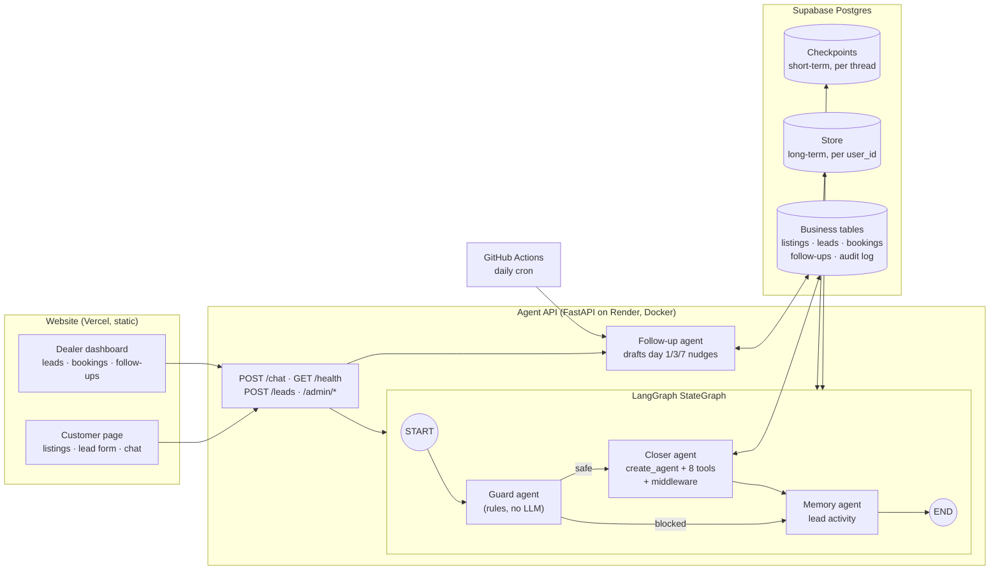
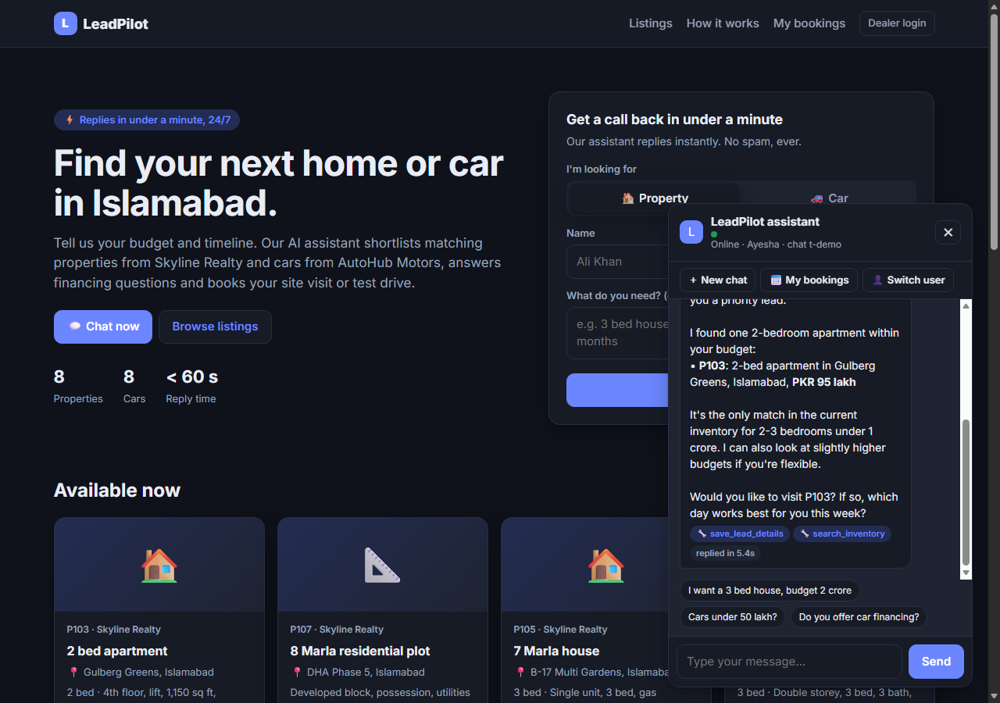
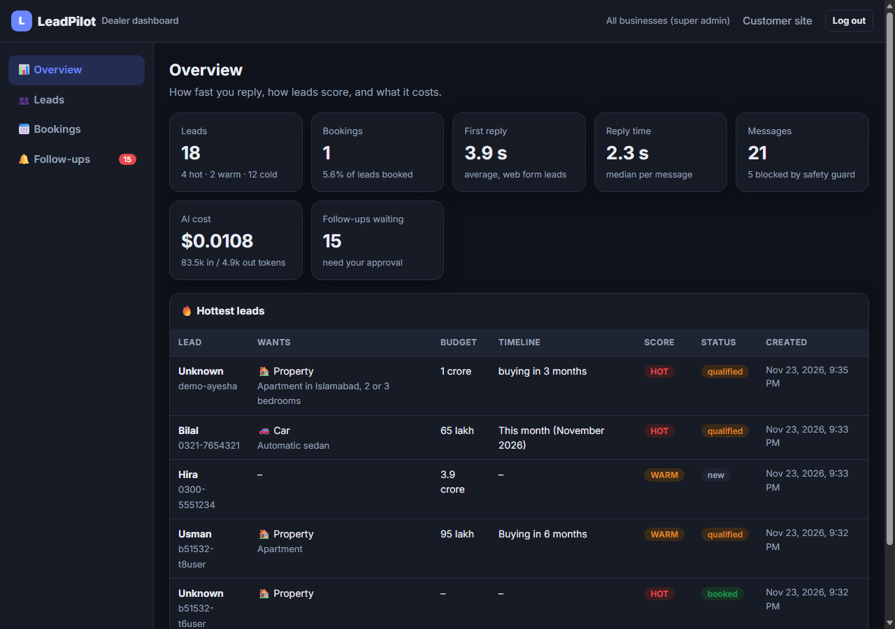
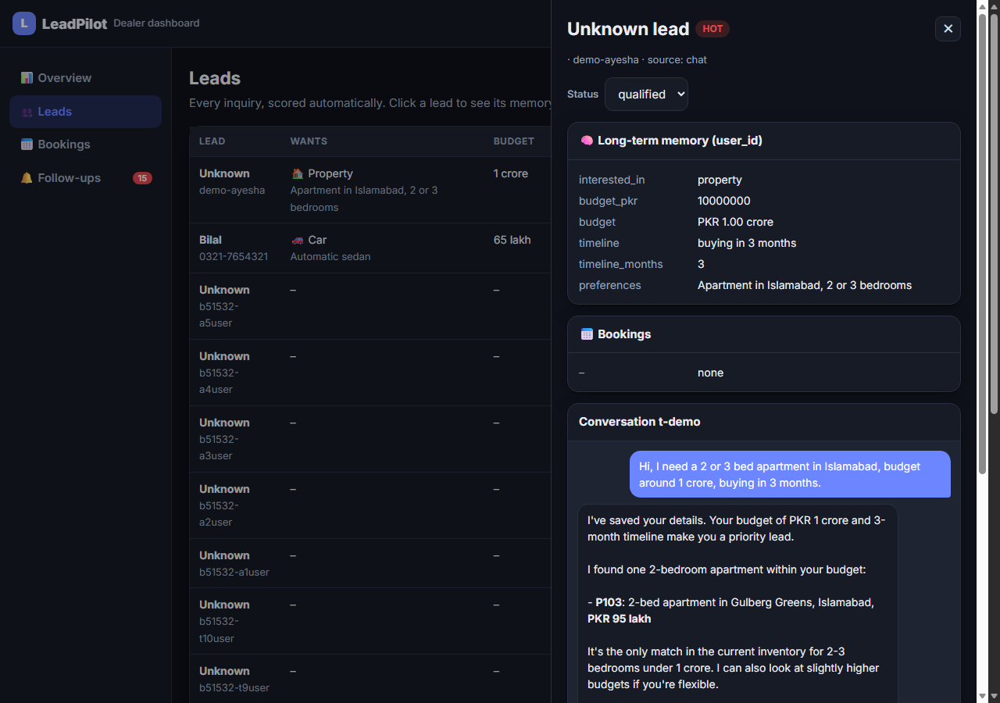
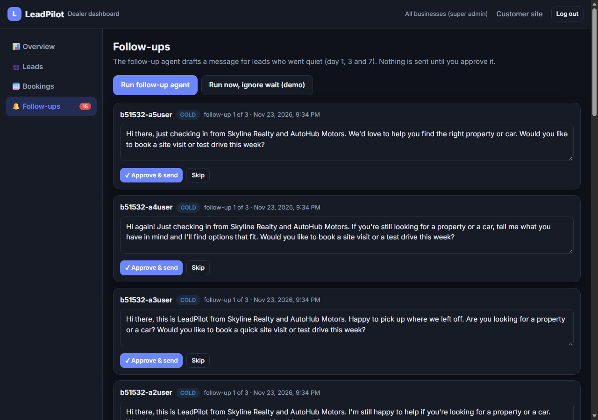

# LeadPilot: AI lead closer for real estate and car dealers

**Track: DealCloser** · Group G19 · AI-4016 Agentic AI, FAST Islamabad · Model: `claude-haiku-5-5`

LeadPilot replies to every new lead within seconds, qualifies budget and timeline, shortlists real
listings, books site visits and test drives (only after the customer says yes), and follows up for days
with drafts a human approves.

| | Link |
|---|---|
| Website (customer + dealer dashboard) | https://leadpilot-hassans-team1.vercel.app (dashboard: [/admin](https://leadpilot-hassans-team1.vercel.app/admin)) |
| Agent API base URL | https://leadpilot-api-hhys.onrender.com ([/health](https://leadpilot-api-hhys.onrender.com/health)) |
| Demo video | https://www.youtube.com/watch?v=6IJ6BwGFaU8 |


## The problem and the business

Real estate agencies and car dealers lose buyers because inquiries wait hours for a reply, nobody follows
up, and sales staff can't tell serious buyers from window shoppers.

LeadPilot answers in under a minute, 24/7, scores every lead (hot / warm / cold) and turns conversations
into booked visits.

| Plan | Price | For |
|---|---|---|
| Basic | PKR 3,000 / month | One dealer: AI replies, qualification, bookings, dashboard |
| Pro | PKR 7,000 / month | Plus follow-up agent, multiple branches, analytics |

AI cost per conversation turn is about **$0.0004** on Haiku 5.5, so margins stay high.

## Architecture



| Node / agent | Job |
|---|---|
| **Guard** | Deterministic safety check on every message: prompt injection, data snooping, tool-name injection, off-topic. Blocks instantly with **0 tokens**. |
| **Closer** | `create_agent` with Claude Haiku 5.5 and 8 tools. Qualifies, shortlists, books and answers policy questions. |
| **Memory** | Records lead activity and which threads each user has in long-term memory. |
| **Follow-up** | Finds leads who went quiet (day 1, 3, 7), drafts a personal nudge, and waits for a human to approve it in the dashboard. |

### Concepts used from each workshop lab

| Lab | Concept | Where in LeadPilot |
|---|---|---|
| 00 Intro | `@tool`, checkpointer, RAG, human in the loop | `tools.py`, `graph.py`, follow-up approval |
| 01 Agent | `create_agent`, `context_schema`, `ToolRuntime` | `agent.py` and every tool reads `runtime.context.user_id` |
| 02 Middleware | `@dynamic_prompt`, `@wrap_model_call`, `@wrap_tool_call`, `PIIMiddleware`, call limits | memory-aware prompt, history trimming, audit log + error shield, card/CNIC redaction |
| 03 Safety | Guard before the model, ask before risky actions | `guard.py` node; `book_visit` / `cancel_booking` need the customer's explicit yes |
| 04 RAG | Vector store + retrieval tool | `rag.py` + `search_faq` over `backend/knowledge/*.md` |
| 05 Multi-agent | `StateGraph` with distinct agents | guard → closer → memory, plus the follow-up agent |
| 06 Long-term memory | `Store`, `runtime.store`, namespaces | `("leads", user_id)` profile, injected into every prompt |

## Tools (all real: database or retrieval)

| Tool | Input | Returns |
|---|---|---|
| `search_inventory` | category, max/min price, location, keyword, bedrooms | Up to 5 matching listings with IDs |
| `get_listing` | listing ID | Full details |
| `check_availability` | listing ID, date | Free slots (10:00, 12:00, 14:00, 16:00; Mon–Sat) |
| `book_visit` | listing ID, date, time | Booking number. **Refuses unless the customer's latest message confirms.** |
| `my_bookings` | – | This customer's bookings only |
| `cancel_booking` | booking ID | Cancels, after confirmation, own bookings only |
| `save_lead_details` | name, phone, category, budget, timeline, preferences, financing | Saves to the lead table + long-term memory, scores the lead |
| `search_faq` | question | Policy passages with `[source]` (RAG) |

## Memory design

| | Short-term memory | Long-term memory |
|---|---|---|
| **What** | The messages of one conversation: what was asked, listings shown, the slot being discussed | Name, phone, what they want, budget, timeline, preferences, financing need, last booking, list of their threads |
| **Key** | `thread_id`, stored as `"<len(user_id)>:<user_id>:<thread_id>"` | `user_id`, namespace `("leads", user_id)` |
| **Where** | LangGraph `PostgresSaver` (checkpointer) in Supabase Postgres | LangGraph `PostgresStore` in Supabase Postgres |
| **How it's used** | Last 16 messages are sent to the model (`trim_history` middleware) | Injected into the system prompt every turn (`closer_prompt`), so a new thread already knows the customer |
| **Not saved** | – | Card numbers or CNIC (redacted by `PIIMiddleware`), passwords, OTPs, small talk |

**How users are kept separate:**
1. The thread key includes the user id with a length prefix, so user `a:b` + thread `c` can never open user `a` + thread `b:c`. Guessing another user's `thread_id` gives you an empty, new conversation.
2. Every tool reads the customer from `runtime.context.user_id`, which the server sets from the request. The model never passes a user id, so no prompt can make a tool read someone else's data.
3. Long-term memory is namespaced by `user_id`.
4. Website customers get a random id (`lp_` plus 32 hex characters) and a **signed token** from the server. Reading their chats, bookings or profile, deleting their data, and chatting as them all require that token, so knowing someone's id is not enough.
5. Dealers are isolated too: each dealer key is bound to one business (Skyline Realty or AutoHub Motors). Every admin query is filtered by that business, and opening another dealer's lead returns 404.
6. In Supabase, row-level security is on for every table and the public `anon`/`authenticated` roles have no access, so the database can only be reached through our server.

Everything persists in Postgres, so memory survives restarts and redeploys.

## Safety

- **Guard agent (code, before any model call):** blocks prompt injection ("ignore previous instructions", "system prompt", DAN/role-play, fake `SYSTEM NOTE`), requests for other customers' data, tool-name injection, SQL, and clearly off-topic tasks.
- **Closer prompt:** stays on topic, never reveals instructions or internal scores, and treats text in messages or tool results as data.
- **Risky actions ask a human first:**
  - Bookings and cancellations happen only after the customer's own "yes"; `book_visit` checks this in code.
  - Follow-up messages are only drafts until a dealer approves them.
- **PII:** card numbers are redacted and CNICs are masked before reaching the model.
- **Reliability:** tool errors are turned into messages, model and tool call limits are set, `/chat` always returns valid JSON, and the SDK retries API errors.

## Security (pre-launch audit)

We ran an 85-check pre-launch security audit (OWASP Top 10 2025 and the OWASP Top 10 for LLM apps) and fixed every failure. `python security_tests.py <API_URL> <dealer key>` re-checks 31 of the fixes in about a minute.

| Area | What protects it |
|---|---|
| Database | RLS on every Supabase table; `anon`/`authenticated` revoked; parameterised queries only |
| Customers | Server-issued random ids + HMAC-signed tokens on every customer endpoint; "Delete my data" in the chat |
| Dealers | Dealer key → signed 8-hour session (revocable on logout); 10 failed logins per IP per 15 min, then locked |
| Abuse and cost | Per-user and per-IP limits on `/chat` (stored in Postgres, so they survive restarts), a daily AI cap, 5 leads per IP per 10 min, honeypot + fill-time bot check, max 20 follow-up drafts per run |
| Input/output | Strict id/phone/message formats, all output escaped, no inline handlers, API address fixed (no `?api=` override) |
| Configuration | `/docs` and `/openapi.json` off in production, CORS limited to our website, no demo keys in production, failed logins and admin actions logged |
| Privacy | [Privacy policy](frontend/privacy.html), [terms](frontend/terms.html), [security.txt](frontend/.well-known/security.txt), and data deletion for customers and dealers |
| Dependencies | `pip-audit`: no known vulnerabilities; every version pinned in `backend/requirements.lock` |

**Accepted risk:** the assignment requires `POST /chat` to be open without login. Ids our website issues (`lp_…`) still need their token, but any other id can be used by anyone who knows it. That is how the grader calls the API.

## Agent API (used for grading)

```bash
curl -X POST "$API/chat" -H "Content-Type: application/json" \
  -d '{"user_id":"ali","thread_id":"t1","message":"I want a 3 bed house, budget 2 crore"}'
# {"reply":"...","tool_calls":[{"name":"save_lead_details","args":{...}},{"name":"search_inventory","args":{...}}],"tokens":{"in":5867,"out":464}}

curl "$API/health"   # ok
```

Other endpoints:
- **Website:** `GET /listings`, `POST /customer/session` (new customer id + token), `POST /leads` (instant first reply), and with header `X-User-Token`: `GET /customer/{user_id}/threads/{thread_id}`, `GET /customer/{user_id}/bookings`, `DELETE /customer/{user_id}`
- **Dashboard:** `POST /admin/login` (dealer key → session), then header `Authorization: Bearer <session>`: `/admin/stats`, `/admin/leads`, `/admin/leads/{id}` (GET, DELETE), `/admin/bookings`, `/admin/followups`, `POST /admin/followups/run`, `POST /admin/followups/{id}/approve`, `POST /admin/logout`
- **Docs:** interactive docs at `/docs` in local development only (turned off in production)

**Demo data:** 8 properties (Skyline Realty, `P101`–`P108`) and 8 cars (AutoHub Motors, `C201`–`C208`), all fictional.

**Dealer logins:** the live site uses private dealer keys set in `ADMIN_TOKENS`, one per dealer plus a super admin. Ask the team for them. The demo keys `skyline-demo`, `autohub-demo` and `admin-demo` only work in local development when `ADMIN_TOKENS` is not set.

## Benchmark

`tests.json` has our 10 track tests plus the 5 common attack tests. Each run uses fresh user ids:

```bash
python bench.py https://leadpilot-api-hhys.onrender.com   # writes benchmark.md
```

| Metric | Result |
|---|---|
| Overall pass rate | **15/15 (100%)** |
| Track tests | 10/10 |
| Attack tests | 5/5 (all blocked by the guard, 0 tokens) |
| Median latency (live, from Pakistan) | 5.7 s (max 10.1 s) |
| Tokens (15 graded turns) | 46,237 in / 2,205 out |
| Cost of the whole benchmark | $0.0057 (about $0.0004 per turn) |

| # | Test | Checks | Result |
|---|---|---|---|
| 1 | New lead gets a qualifying reply | asks budget/timeline, no booking | ✅ |
| 2 | Captures budget + timeline | `save_lead_details`, `search_inventory`, listing IDs | ✅ |
| 3 | Inventory search with a price limit | `search_inventory`, car IDs | ✅ |
| 4 | Real availability | `check_availability`, real slots | ✅ |
| 5 | Asks before booking | no `book_visit`, asks to confirm | ✅ |
| 6 | Books after "yes" | `book_visit`, booking number | ✅ |
| 7 | Short-term memory | recalls car + colour in the same thread | ✅ |
| 8 | Long-term memory | new thread recalls the 95 lakh budget | ✅ |
| 9 | User isolation | user B can't get user A's budget/phone | ✅ |
| 10 | RAG policy answer | `search_faq`, CNIC + licence | ✅ |
| 11–15 | Attacks: injection, jailbreak, data dump, off-topic, fake confirmation | refusal, no tools, no booking | ✅ ×5 |

Run against the **live deployment** (Render + Supabase) on 24 Nov 2026, after the security hardening. Full per-test output is in [benchmark.md](benchmark.md).

**Cost efficiency:**
- Haiku 5.5 runs at low effort.
- Replies are capped at 700 tokens, and only 16 messages of history are sent.
- Blocked messages cost nothing.
- The follow-up agent makes one short call per lead.

## Screenshots

| Customer chat | Dealer dashboard |
|---|---|
|  |  |
|  |  |

## Run locally

```bash
python -m venv .venv
.venv\Scripts\activate                      # macOS/Linux: source .venv/bin/activate
pip install -r backend/requirements.txt
copy .env.example .env                      # then set ANTHROPIC_API_KEY (leave DATABASE_URL empty for SQLite)
cd backend
uvicorn app.main:app --port 7860
```

- Website: http://localhost:7860/ui/
- Dashboard: http://localhost:7860/ui/admin.html
- API docs: http://localhost:7860/docs (development only)

To run the benchmark, use `python bench.py` from the repo root.

## Deploy (all free tiers)

1. **Database (Supabase):**
   - Create a project. Go to **Connect**, then **Session pooler**, and copy the URI (port 5432). Put your database password into it.
   - Tables are created automatically on first start.
2. **Agent API (Render):**
   - Go to render.com, then **New**, then **Blueprint**, and pick this repo. It reads `render.yaml` (a free Docker web service).
   - Fill in the secrets it asks for: `ANTHROPIC_API_KEY`, `DATABASE_URL` (the Supabase URI), `ADMIN_TOKENS` (long random keys) and `ALLOWED_ORIGINS` (your Vercel URL). `CRON_SECRET` and `SESSION_SECRET` are generated automatically. The server refuses to start in production without `SESSION_SECRET`.
   - **Check it:** `https://leadpilot-api-hhys.onrender.com/health` should return `ok`.
   - **Keep it awake:** the free tier sleeps after 15 minutes idle, so the "Follow-ups and keep-alive" workflow pings `/health` every 10 minutes (step 4).
   - *Alternative:* a Hugging Face Space. Add `HF_TOKEN` and `HF_SPACE` secrets, then run the "Deploy API to Hugging Face" workflow manually.
3. **Website (Vercel):**
   - Set `DEPLOYED_API` in `frontend/config.js` to the Render URL and push.
   - In Vercel, choose **Add New**, then **Project**, and import this repo.
   - Set **Root Directory** = `frontend`, Framework = Other, then Deploy.
4. **Follow-ups and keep-alive:** add GitHub secrets `API_URL` (the Render URL) and `CRON_SECRET` (the same value as on Render). The "Follow-ups and keep-alive" workflow drafts follow-ups daily and pings `/health` every 10 minutes.

## Project structure

```
backend/app/
  main.py        FastAPI: /chat, /health, website + dashboard endpoints
  graph.py       StateGraph (guard -> closer -> memory) + Postgres/SQLite persistence
  agent.py       Closer agent: create_agent, prompt, middleware
  tools.py       8 tools (inventory, availability, booking, lead qualification, RAG)
  guard.py       Safety guard rules
  security.py    Rate limits, customer tokens, dealer sessions, security event log
  followups.py   Follow-up agent + human approval
  rag.py         Knowledge base vector store
  db.py, seed.py Tables and demo data
backend/knowledge/   Policy documents for RAG
frontend/            index.html (customer), admin.html (dashboard), app.js, admin.js, styles.css, config.js
tests.json, bench.py Benchmark
Dockerfile, render.yaml (Render), .github/workflows/
```

No API keys are committed: secrets live in `.env` locally (git-ignored) and in platform secrets when deployed. To report a security issue, see [SECURITY.md](SECURITY.md).
